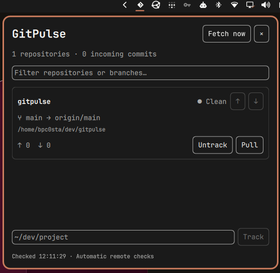

# GitPulse

A Python + Quickshell widget for the Omarchy topbar. It keeps track of selected Git repositories while its menu is closed, alerts you to incoming commits, and lets you pull from the menu. Colors, fonts, borders, and popup placement use Omarchy's live system theme.



## Install

GitPulse requires **Omarchy with its Quickshell shell and plugin API**, an active graphical shell session, Python 3.10+, Git, and `notify-send` (provided by `libnotify`). This plugin uses Omarchy's UI components and is not a standalone Quickshell configuration. No Python packages or virtual environment are needed.

If dependencies are missing, install them with:

```sh
omarchy pkg add python git libnotify
```

Install from a terminal in your Omarchy session:

```sh
omarchy plugin add https://github.com/bpcosta1/gitpulse.git --enable
```

Follow the prompts to enable GitPulse and choose its bar section. The plugin ID is `bpc0sta.gitpulse`; the default section is the right side of the bar. Click the Git icon, enter a repository path such as `~/dev/my-project`, and select **Track**. The initial list is empty on a fresh installation.

The enabled widget loads automatically when the shell starts. No separate service or autostart entry is needed. To enable it later:

```sh
omarchy plugin enable bpc0sta.gitpulse --section right
```

### Install from a source checkout

For development, or to keep a separate checkout:

```sh
mkdir -p ~/dev
git clone https://github.com/bpcosta1/gitpulse.git ~/dev/gitpulse
cd ~/dev/gitpulse
./gitpulse install
./gitpulse add ~/dev/my-project
./gitpulse open
```

The source installer copies the plugin into `~/.config/omarchy/plugins/bpc0sta.gitpulse`, backs up `shell.json`, and enables the widget in the right bar section. Run it from the checkout after each source update.

## Use

Click the Git icon in the right side of the bar. Its badge shows the total incoming commit count, or `!` when a repository or fetch needs attention.

- **Track**: enter a local repository path, such as `~/dev/project`.
- **Untrack**: remove a repository from the list; its files are kept.
- **↑ / ↓ beside each repository name**: move it up or down. The order is saved immediately and persists across restarts. When filtering, it moves relative to the next visible repository.
- **Fetch now**: check upstreams immediately and refresh all statuses.
- **Pull**: fetch the selected branch's remote, then fast-forward to its upstream.
- Filter by repository name, path, or branch. Close with Escape, the × button, or an outside click.

The menu shows branch, upstream, dirty entry count, and commits ahead/behind. GitPulse refuses to pull dirty trees, detached HEADs, branches without upstreams, diverged branches, and repositories with an ongoing merge/rebase/cherry-pick/bisect. It never automatically stashes, rebases, or creates merge commits. Git failures are shown in the menu.

## Background checks and notifications

Local status is checked every 15 seconds while the widget is enabled, including with the menu closed. Each tracked branch's configured remote is fetched at startup and then every five minutes. This updates local refs; only an explicit **Pull** changes working files.

Incoming commits generate a desktop notification. The upstream revision is remembered on disk so polling, multiple bar instances, or restarting the shell does not repeatedly notify for the same incoming revision. Existing unpulled commits are reported on the first scan too. After catching up, the notification state resets.

Network or authentication failures retain locally known counts and display a fetch error. Fetches use existing Git credentials with interactive prompts disabled and SSH batch mode enabled. Fix authentication in your terminal if needed. Repositories without upstreams are not fetched. Disabled widgets do not monitor repositories.

## Update or remove

For an installation managed by `omarchy plugin add`:

```sh
omarchy plugin update bpc0sta.gitpulse
```

For an installation copied from a source checkout:

```sh
cd ~/dev/gitpulse
git pull --ff-only
./gitpulse install
```

If Quickshell retains the previous menu after updating, run `omarchy restart shell` to load the new version.

Disable or remove the widget with:

```sh
omarchy plugin disable bpc0sta.gitpulse
omarchy plugin remove bpc0sta.gitpulse
```

Disabling stops background monitoring. Removing the plugin leaves tracked repositories and GitPulse's configuration/state outside the plugin directory intact.

## Command-line use

Run these commands from your source checkout, or from `~/.config/omarchy/plugins/bpc0sta.gitpulse` when installed with `omarchy plugin add`:

```sh
./gitpulse add ~/dev/my-project
./gitpulse open
./gitpulse toggle
./gitpulse list
./gitpulse remove ~/dev/my-project
./gitpulse move ~/dev/my-project before ~/dev/another-project
./gitpulse status            # Local JSON snapshot; no fetch or notifications
./gitpulse monitor           # Fetch if due, notify, emit JSON
./gitpulse monitor --fetch   # Fetch immediately, notify, emit JSON
./gitpulse pull ~/dev/my-project
```

`open` and `toggle` control the installed bar widget. There is no separate popup process or daemon to start. Shell startup loads the enabled widget automatically.

## Configuration

`~/.config/gitpulse/config.json` (or `$XDG_CONFIG_HOME/gitpulse/config.json`):

```json
{
  "repositories": ["/home/you/dev/project"],
  "fetch_interval": 300
}
```

`fetch_interval` is seconds (minimum 60, default 300). Configuration is reread on every scan. The CLI supports `--config /path/to/config.json` before commands for separate repository lists; the installed bar always uses the default config. Notification and fetch state lives under `$XDG_STATE_HOME/gitpulse`, normally `~/.local/state/gitpulse`.

Dirty means staged, unstaged, untracked, or conflicted entries; ignored files are excluded. Untracked directories can count as one entry. No upstream is shown as unavailable, not zero. Unborn branches and linked worktrees are supported; bare repositories are not working trees.

Scans use up to eight concurrent workers. Actions and monitor runs for the same configuration are serialized across bar instances. Git read commands time out after ten seconds, fetches after 45 seconds, and fast-forward operations after 60 seconds. A slow remote delays the complete snapshot; the UI remains responsive.

## Troubleshooting

- **`omarchy plugin` is unavailable:** an Omarchy release with the Quickshell plugin system is required. A plain Quickshell installation cannot provide the shared Omarchy components.
- **The icon is missing:** run `omarchy-shell shell rescanPlugins`, then `omarchy plugin enable bpc0sta.gitpulse --section right`. If the menu remains outdated, run `omarchy restart shell`.
- **No incoming commit notifications:** the repository needs a branch with an upstream, a successful fetch, and incoming commits. Use **Fetch now** to check immediately. `notify-send` must be available, and desktop notifications must be allowed. A revision already reported is not reported again on every scan.
- **Fetch or authentication errors:** run `git -C /path/to/repository fetch` in a terminal and resolve credentials, SSH agent access, or host verification there. GitPulse's background fetches cannot ask interactive questions.
- **No upstream:** for an existing remote branch, set tracking in a terminal, for example `git -C /path/to/repository branch --set-upstream-to=origin/main main`, replacing the remote and branch names as appropriate.
- **Pull is disabled or refused:** commit or stash local changes, check out a tracked branch, and finish any ongoing Git operation. Diverged branches need to be reconciled in your usual Git client.

## Development

```sh
python3 -m unittest discover -s tests -v
./gitpulse install
```

- `gitpulse.py`: status collection, periodic fetches, notification deduplication, pull guards, CLI, installer.
- `Widget.qml`: native Omarchy bar icon and themed repository menu.
- `manifest.json`: Omarchy plugin registration.
- `gitpulse`: launcher resolving its own directory.

Tests use temporary local remotes to verify divergence, fast-forward pulls, refusal of unsafe pulls, fetch scheduling/failure, persistent notification deduplication, worktrees, and Git status edge cases.
