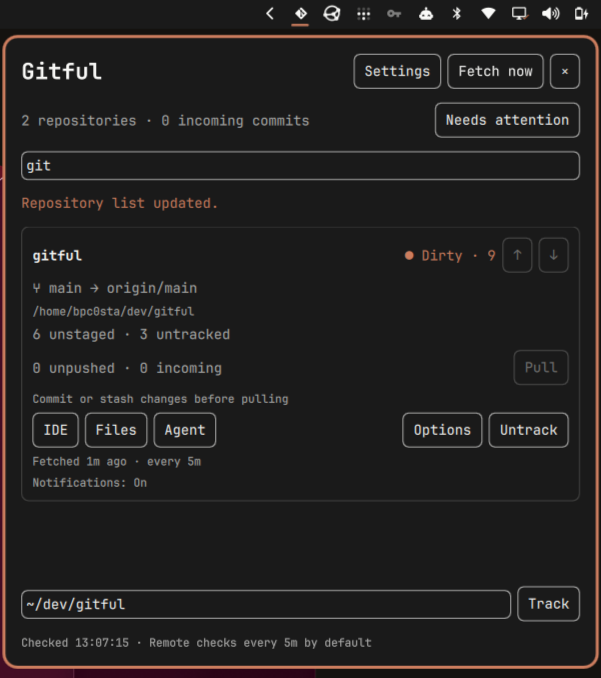
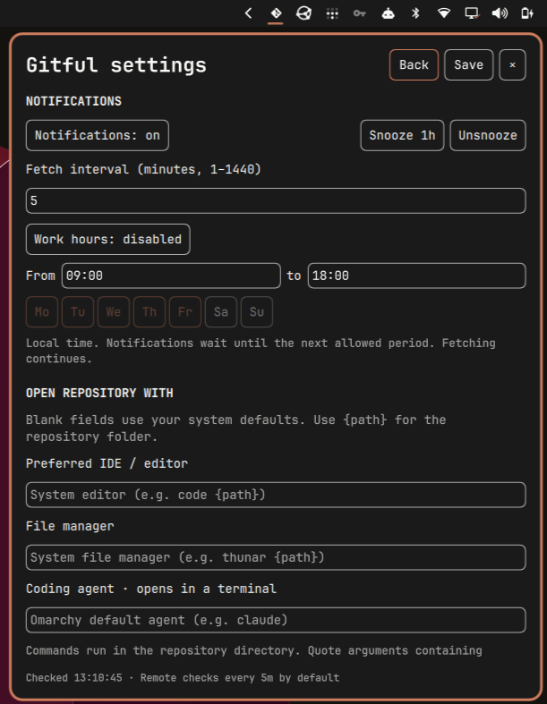

# Gitful

**Git status and development shortcuts for your Omarchy bar.**

Keep your repositories within reach. See changes, unpushed commits, incoming updates, stashes, and conflicts at a glance. Open a project in your preferred editor, file manager, or coding agent, pull incoming changes, and choose when to receive notifications. Built with Python and Quickshell, Gitful follows your system theme.

| Repositories | Settings |
| --- | --- |
|  |  |

Previously called GitPulse. The plugin ID (`bpc0sta.gitpulse`) and config/state paths retain `gitpulse` for compatibility. Use `./gitful` for the CLI; `./gitpulse` remains supported.

## Install

Gitful requires **Omarchy with its Quickshell shell and plugin API**, an active graphical shell session, Python 3.10+, Git, and `notify-send` (provided by `libnotify`). This plugin uses Omarchy's UI components and is not a standalone Quickshell configuration. No Python packages or virtual environment are needed.

If dependencies are missing, install them with:

```sh
omarchy pkg add python git libnotify
```

Install from a terminal in your Omarchy session:

```sh
omarchy plugin add https://github.com/bpcosta1/gitful.git --enable
```

Follow the prompts to enable Gitful and choose its bar section. The plugin ID is `bpc0sta.gitpulse`; the default section is the right side of the bar. Click the Git icon, enter a repository path such as `~/dev/my-project`, and select **Track**. The initial list is empty on a fresh installation.

The enabled widget loads automatically when the shell starts. No separate service or autostart entry is needed. To enable it later:

```sh
omarchy plugin enable bpc0sta.gitpulse --section right
```

### Install from a source checkout

For development, or to keep a separate checkout:

```sh
mkdir -p ~/dev
git clone https://github.com/bpcosta1/gitful.git ~/dev/gitful
cd ~/dev/gitful
./gitful install
./gitful add ~/dev/my-project
./gitful open
```

The source installer copies the plugin into `~/.config/omarchy/plugins/bpc0sta.gitpulse`, backs up `shell.json`, and enables the widget in the right bar section. Run it from the checkout after each source update.

## Use

Click the Git icon in the right side of the bar. Its badge shows the total incoming commit count, or `!` when a repository or fetch needs attention.

- **Track**: enter a local repository path, such as `~/dev/project`.
- **Untrack**: remove a repository from the list; its files are kept.
- **↑ / ↓ beside each repository name**: move it up or down. The order is saved immediately and persists across restarts. When filtering, it moves relative to the next visible repository.
- **Fetch now**: check upstreams immediately and refresh all statuses.
- **Pull**: fetch the selected branch's remote, then fast-forward to its upstream.
- **IDE / Files / Agent**: open the repository in your preferred editor, file manager, or coding agent. Applications start with the repository as their working directory.
- **Options** on a repository: set its notification policy, snooze, fetch interval, and application overrides.
- **Settings** in the header: set global application preferences, notifications, fetch intervals, and work hours.
- **Needs attention**: show repositories with local changes, unpushed/incoming commits, stashes, ongoing Git operations, or errors. Your saved order is preserved.
- Filter by repository name, path, or branch. Close with Escape, the × button, or an outside click.

The menu shows branch, upstream, staged/unstaged/untracked counts, stashes, conflicts, ongoing Git operations, and unpushed/incoming commits relative to the configured upstream. One file may have both staged and unstaged changes; conflicted entries are counted separately. The last successful fetch and stale-ref warnings help distinguish cached information from a successful remote check. Conflicts also flag the bar icon.

Gitful refuses to pull dirty trees, detached HEADs, branches without upstreams, diverged branches, and repositories with an ongoing merge/rebase/cherry-pick/bisect. It never automatically stashes, rebases, or creates merge commits. Git failures are shown in the menu.

### Open your development environment

By default, **IDE** uses the editor selected in Omarchy defaults, **Files** uses your default desktop file manager, and **Agent** starts the coding agent selected in Omarchy defaults inside your default terminal. The agent is launched interactively with its normal permissions and no task prompt. Applications and agents must already be installed and configured.

Set custom commands in **Settings**, or override them for one repository under **Options**. For example:

| Action | Example command |
| --- | --- |
| IDE | `code --new-window {path}` |
| Files | `thunar {path}` |
| Agent | `claude` |

Use `{path}` to insert the repository folder. Editor/file-manager commands receive the path automatically if you omit the placeholder. Agent commands run in a new terminal in the repository directory. For terminal editors, configure a terminal command such as `xdg-terminal-exec --dir={path} nvim {path}`. Blank command fields restore defaults; blank repository overrides inherit global commands.

Commands are parsed into arguments and launched directly: quoting is supported, while pipes, shell substitutions, and environment-variable expansion are not performed. Repository paths containing spaces are kept intact. A custom command requiring shell behavior can point to your own launcher script.

## Background checks and notifications

Local status is checked every 15 seconds while the widget is enabled, including with the menu closed. Each tracked branch's configured remote is fetched when first monitored and then every five minutes by default. The previous fetch attempt is remembered across shell restarts. This updates local refs; only an explicit **Pull** changes working files.

Incoming commits generate a desktop notification. The upstream revision is remembered on disk so polling, multiple bar instances, or restarting the shell does not repeatedly notify for the same incoming revision. Existing unpulled commits are reported on the first scan too. After catching up, the notification state resets.

Use **Settings** for global notification preferences and **Options** for per-repository controls:

- Mute notifications globally or for one repository.
- Snooze for an hour, or clear an active snooze with **Unsnooze**.
- Choose global work hours and weekdays using your local timezone. Overnight periods are supported and belong to the day they start on.
- Set fetch intervals from 1 to 1440 minutes. A blank repository interval inherits the global setting.

Select **Save** in the settings header after changing mute, work hours, launchers, or fetch intervals. Snooze/unsnooze buttons apply immediately. Suppression leaves monitoring and fetches running; pending incoming revisions can notify on the first scan after notifications become allowed again. Global mute, global snooze, and work hours apply to every repository. The repository card shows its effective notification state.

Network or authentication failures retain locally known counts and display a fetch error. Fetches use existing Git credentials with interactive prompts disabled and SSH batch mode enabled. Fix authentication in your terminal if needed. Repositories without upstreams are not fetched. Disabled widgets do not monitor repositories.

## Update or remove

For an installation managed by `omarchy plugin add`:

```sh
omarchy plugin update bpc0sta.gitpulse
```

For an installation copied from a source checkout:

```sh
cd ~/dev/gitful
git pull --ff-only
./gitful install
```

If Quickshell retains the previous menu after updating, run `omarchy restart shell` to load the new version.

Disable or remove the widget with:

```sh
omarchy plugin disable bpc0sta.gitpulse
omarchy plugin remove bpc0sta.gitpulse
```

Disabling stops background monitoring. Removing the plugin leaves tracked repositories and Gitful's configuration/state outside the plugin directory intact.

## Command-line use

Run these commands from your source checkout, or from `~/.config/omarchy/plugins/bpc0sta.gitpulse` when installed with `omarchy plugin add`:

```sh
./gitful add ~/dev/my-project
./gitful open
./gitful toggle
./gitful list
./gitful remove ~/dev/my-project
./gitful move ~/dev/my-project before ~/dev/another-project
./gitful status            # Local JSON snapshot; no fetch or notifications
./gitful monitor           # Fetch if due, notify, emit JSON
./gitful monitor --fetch   # Fetch immediately, notify, emit JSON
./gitful pull ~/dev/my-project
./gitful launch ~/dev/my-project editor  # Also: files, agent
./gitful settings                       # Show global preferences
./gitful settings --set '{"notifications": false}'
./gitful settings --repo ~/dev/my-project --set '{"snooze_minutes": 60}'
./gitful settings --repo ~/dev/my-project --set '{"fetch_interval": 900}'
```

`open` and `toggle` control the installed bar widget. There is no separate popup process or daemon to start. Shell startup loads the enabled widget automatically.

## Configuration

`~/.config/gitpulse/config.json` (or `$XDG_CONFIG_HOME/gitpulse/config.json`):

```json
{
  "repositories": ["/home/you/dev/project"],
  "fetch_interval": 300,
  "notifications": true,
  "work_hours": {
    "enabled": false,
    "start": "09:00",
    "end": "18:00",
    "weekdays": [0, 1, 2, 3, 4]
  },
  "launchers": {
    "editor": ["code", "--new-window", "{path}"]
  },
  "repository_settings": {
    "/home/you/dev/project": {
      "fetch_interval": 900,
      "notifications": true
    }
  }
}
```

`fetch_interval` is seconds (60-86400, default 300). `snoozed_until`, when present, is a Unix timestamp. Workday numbers run from 0 (Monday) to 6 (Sunday). Launcher commands are stored as arrays of arguments in the config file; the settings UI and CLI accept quoted command strings. Per-repository keys use absolute, resolved folder paths. Existing configs containing only `repositories` continue to work.

Configuration is reread on every scan. The CLI supports `--config /path/to/config.json` before commands for separate repository lists; the installed bar always uses the default config. Notification and fetch state lives under `$XDG_STATE_HOME/gitpulse`, normally `~/.local/state/gitpulse`.

Dirty means staged, unstaged, untracked, or conflicted entries; ignored files are excluded. Untracked directories can count as one entry. No upstream is shown as unavailable, not zero. Unborn branches and linked worktrees are supported; bare repositories are not working trees.

Scans use up to eight concurrent workers. Actions and monitor runs for the same configuration are serialized across bar instances. Git read commands time out after ten seconds, fetches after 45 seconds, and fast-forward operations after 60 seconds. A slow remote delays the complete snapshot; the UI remains responsive.

## Troubleshooting

- **`omarchy plugin` is unavailable:** an Omarchy release with the Quickshell plugin system is required. A plain Quickshell installation cannot provide the shared Omarchy components.
- **The icon is missing:** run `omarchy-shell shell rescanPlugins`, then `omarchy plugin enable bpc0sta.gitpulse --section right`. If the menu remains outdated, run `omarchy restart shell`.
- **No incoming commit notifications:** the repository needs a branch with an upstream, a successful fetch, and incoming commits. Use **Fetch now** to check immediately. `notify-send` must be available, and desktop notifications must be allowed. A revision already reported is not reported again on every scan.
- **Fetch or authentication errors:** run `git -C /path/to/repository fetch` in a terminal and resolve credentials, SSH agent access, or host verification there. Gitful's background fetches cannot ask interactive questions.
- **No upstream:** for an existing remote branch, set tracking in a terminal, for example `git -C /path/to/repository branch --set-upstream-to=origin/main main`, replacing the remote and branch names as appropriate.
- **Pull is disabled or refused:** commit or stash local changes, check out a tracked branch, and finish any ongoing Git operation. Diverged branches need to be reconciled in your usual Git client.
- **Agent is not configured:** select a default agent in Omarchy's defaults menu or enter an installed agent command in Gitful Settings. The agent's own account setup is handled by that application.
- **An application does not open:** check that its configured executable is installed and available on your shell's PATH. Run the command from the repository directory in a terminal to diagnose application-specific errors. An accepted launch confirms the process started; the external application may report later failures separately.

## Deferred integrations

CI status, failed GitHub Actions notifications, pull requests, and other hosting-provider features are deferred. They require authenticated external API access, polling/rate-limit handling, and provider-specific maintenance. Gitful currently monitors local Git state and configured Git remotes, without a hosting-provider account integration.

## Development

```sh
python3 -m unittest discover -s tests -v
./gitful install
```

- `gitpulse.py`: status collection, periodic fetches, notification deduplication, pull guards, CLI, installer.
- `Widget.qml`: native Omarchy bar icon and themed repository menu.
- `SettingsForm.qml`: global and per-repository preferences UI.
- `manifest.json`: Omarchy plugin registration.
- `gitful`: launcher resolving its own directory.
- `gitpulse`: compatible launcher for existing installations.

Tests use temporary local remotes to verify divergence, fast-forward pulls, refusal of unsafe pulls, fetch scheduling/failure, notification suppression/deduplication, worktrees, conflicts, stashes, and Git status edge cases. Launcher tests mock application spawning and verify argument/path handling. Preference tests cover inheritance, validation, and overnight work hours.
